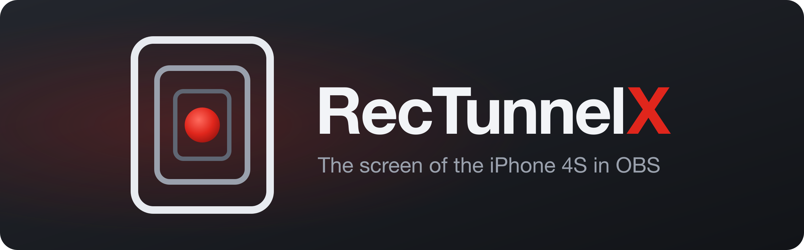
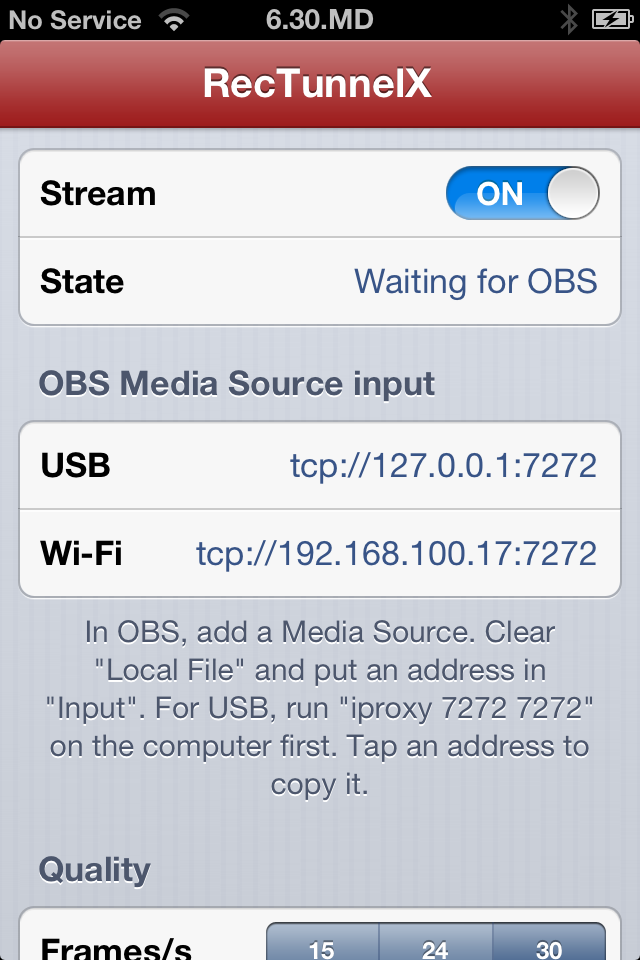
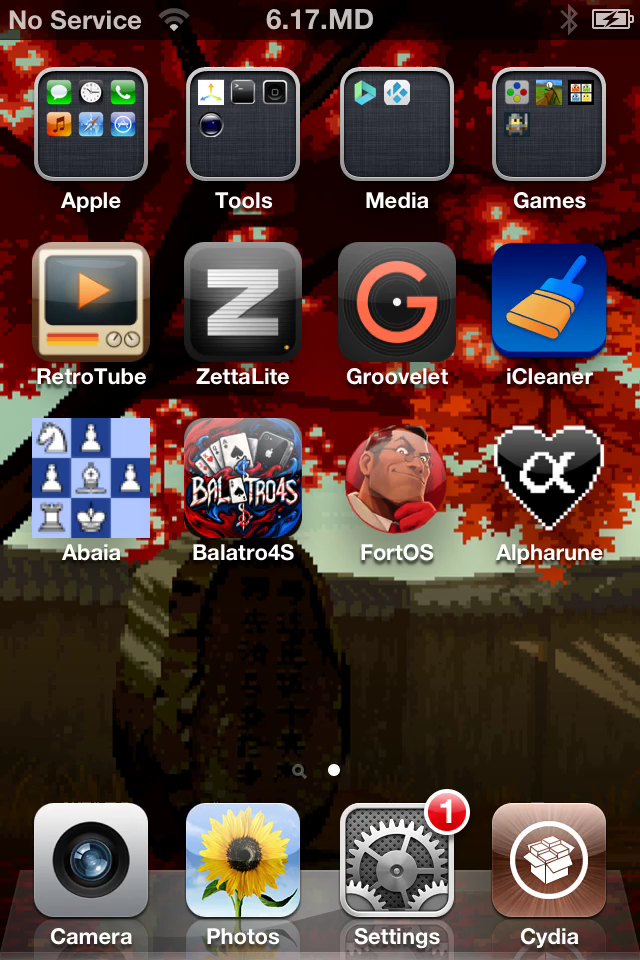

<div align="center">



_Hardware H.264 over USB or Wi-Fi, from a jailbroken phone on iOS 6_


[](LICENSE)
[](https://github.com/Stiven-Gjekaj/RecTunnelX/releases/latest)
[](https://ko-fi.com/stivengjekaj)

<p align="center">
  <a href="#overview"><b>Overview</b></a> |
  <a href="#install"><b>Install</b></a> |
  <a href="#connect-obs"><b>Connect OBS</b></a> |
  <a href="#build"><b>Build</b></a> |
  <a href="docs/architecture.md"><b>Architecture</b></a> |
  <a href="TODO.md"><b>Roadmap</b></a>
</p>

</div>

---

> [!NOTE]
> **Version 0.1.0 is out.** It sends the video of the screen to OBS at up to
> 30 frames per second. The system audio comes in a later version.
> [TODO.md](TODO.md) lists the known problems.
> [docs/decisions.md](docs/decisions.md) holds each decision and its reason.

---

<table>
<tr>
<td width="50%" valign="top">

<p align="center"><i>The app shows the addresses for OBS</i></p>
</td>
<td width="50%" valign="top">

<p align="center"><i>One frame of the stream, decoded on the Mac</i></p>
</td>
</tr>
</table>

## Overview

**RecTunnelX** sends the screen of an iPhone 4S on iOS 6 to OBS on a
computer. OBS shows the screen, and records it or streams it.

A daemon on the phone copies the screen with the hardware accelerator and
encodes it with the hardware H.264 encoder of the A5. It sends the video as
an MPEG transport stream on port 7272. OBS reads it with a normal Media
Source. OBS needs no plugin.

The daemon captures only while a client is connected. With no client, it
uses no CPU. A small app on the phone shows the state and the addresses,
and changes the quality.
[docs/architecture.md](docs/architecture.md) tells how.

## Features

- The video of the whole screen, with any app in front
- 640x960 or 320x480, at 15, 24, or 30 frames per second
- 1.5, 3, or 6 Mbit/s
- Over USB with `iproxy`, or over Wi-Fi
- Raw TCP for OBS, and HTTP at `/stream.ts` for other players
- A new client starts at once with a key frame
- A scene collection for OBS in [obs/RecTunnelX.json](obs/RecTunnelX.json)
- A status in JSON at `/status`

Version 0.1.0 was checked on an iPhone 4S with iOS 6.1.3. Over USB, the
delay from a press of the Home button to the new frame on the Mac was
625 ms, with Activator and SpringBoard in that time.

## Install

You need an iPhone 4S, or another A5 device, with iOS 6 and a jailbreak.

1. Download the `.deb` file from the
   [latest release](https://github.com/Stiven-Gjekaj/RecTunnelX/releases/latest).
2. Copy it to the phone, for example with `scp` to `/tmp/`.
3. On the phone, as root: `dpkg -i /tmp/io.github.stivengjekaj.rectunnelx_*.deb`.

The package installs the daemon and the RecTunnelX app. The daemon starts at
once and at each boot. To remove it: `dpkg -r io.github.stivengjekaj.rectunnelx`.

On iOS 7 or later, or with an APT that has TLS 1.2, you can also add the
Cydia source `https://stiven-gjekaj.github.io/cydia/`. Cydia on iOS 6 cannot
read it, because its APT stops at TLS 1.0 and GitHub accepts only TLS 1.2.
See [the repository](https://github.com/Stiven-Gjekaj/cydia).

## Connect OBS

**Over USB.** Install `libimobiledevice` on the computer. On a Mac:
`brew install libimobiledevice`. Then keep this command open:

```
iproxy 7272 7272
```

**Over Wi-Fi.** Put the phone and the computer on the same network. Open the
RecTunnelX app and read the Wi-Fi address. Some routers do not let two Wi-Fi
clients talk to each other. Then use USB.

**In OBS:**

1. Import [obs/RecTunnelX.json](obs/RecTunnelX.json) with
   **Scene Collection > Import**. It has the source for USB with the
   settings below.
2. Or add a **Media Source** yourself. Clear **Local File**, and set:

| Setting | Value |
| ------- | ----- |
| Input | `tcp://127.0.0.1:7272` for USB, or `tcp://PHONE-ADDRESS:7272` for Wi-Fi |
| Input Format | `mpegts` |
| Network Buffering | 0 MB |
| Reconnect Delay | 2 s |
| Use hardware decoding when available | On |
| FFmpeg Options | `fflags=nobuffer flags=low_delay probesize=32768 analyzeduration=0` |

For a recording of the phone only, set **Settings > Video** to 640x960 for
the canvas and the output, at 30 FPS. Then select the source and press
Cmd+R (Ctrl+R on Windows) to fit it. Use the hardware encoder in
**Settings > Output**.

Keep the screen of the phone on. When the screen sleeps, the picture is
black.

## Build

You need a Mac with Xcode and the iOS 9.3 SDK of Theos.

1. Download `iPhoneOS9.3.sdk.tar.xz` from the releases of
   [theos/sdks](https://github.com/theos/sdks/releases) and unpack it into
   `sdks/`. The result is `sdks/iPhoneOS9.3.sdk`. Git does not track `sdks/`.
2. Run `./fix-sdk.sh` one time. It changes the SDK stubs for the new Apple
   linker and for iOS 6.
3. Build:

| Command | Result |
| ------- | ------ |
| `scripts/app.sh` | `build/RecTunnelX.app` and `build/rectunnelxd` |
| `scripts/deb.sh` | The Cydia package in `build/` |
| `scripts/test.sh` | The tests, on the Mac |
| `scripts/test.sh --phone` | The tests, on the phone |
| `scripts/install.sh` | Builds the package and installs it on the phone |
| `scripts/latency.py` | Measures the delay from the phone to the Mac |
| `scripts/release.sh` | Makes a release of the version in `resources/Info.plist` |

The phone scripts use `ssh iphone4s`. Set up that host in `~/.ssh/config`,
for example with a USB tunnel of `iproxy` on port 2222. They also share the
phone with other projects: `scripts/phone.sh` waits while another project
holds `/tmp/phone.lock` on the phone, or while another ssh connection to the
phone is open.

`probe/` holds tools that run on the phone: `cap.m` saves the screen and
times the copy, `enc.m` encodes the screen to an MPEG-TS file, and `net.m`
tests a TCP connection.

## Support

If you find RecTunnelX useful, you can support its development here.

[](https://ko-fi.com/stivengjekaj)

## Licence

MIT. See [LICENSE](LICENSE). RecTunnelX is not made by the OBS Project, and
the OBS Project does not support it.
